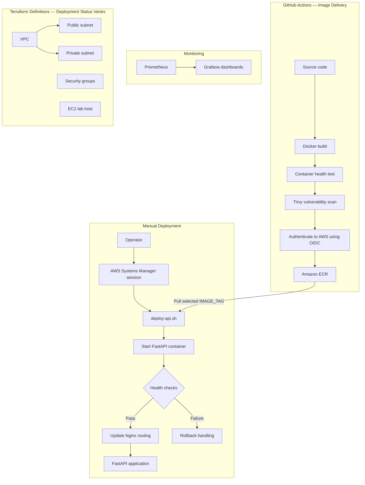

# AWS Platform DevSecOps Lab

A hands-on platform engineering lab combining a containerized FastAPI application, AWS infrastructure definitions, automated image delivery, controlled deployment, and operational monitoring.

## Project Overview

This project demonstrates how application delivery, security scanning, infrastructure as code, and observability fit together in an AWS-based workflow.

The delivery process uses GitHub Actions to build and health-test the application image, scan it with Trivy, and publish it to Amazon ECR using OpenID Connect (OIDC). Deployment is performed manually through AWS Systems Manager (SSM), with Nginx routing, health checks, and rollback handling.

## Technology Stack

| Area | Technologies |
| --- | --- |
| Application | Python, FastAPI |
| Containers | Docker |
| Infrastructure as code | Terraform |
| AWS infrastructure | VPC, public and private subnets, security groups, EC2 |
| Continuous integration | GitHub Actions |
| Container security | Trivy |
| Image registry | Amazon ECR |
| CI authentication | GitHub Actions OIDC |
| Deployment access | AWS Systems Manager |
| Traffic routing | Nginx |
| Monitoring | Prometheus, Grafana |

## Delivery Workflow

1. GitHub Actions builds the Docker image.
2. The workflow starts the application container and tests its health.
3. Trivy scans the container image for vulnerabilities.
4. GitHub Actions authenticates to AWS through OIDC and pushes the image to ECR.
5. An operator initiates deployment manually through SSM.
6. The deployment script starts the selected image and checks application health.
7. Nginx routing is updated, with rollback handling available if deployment fails.

Image publication and application deployment are separate operations. Publishing an image to ECR does not automatically deploy it.

## Infrastructure as Code

The Terraform configuration under `terraform/environments/dev/` defines AWS networking and compute resources, including:

- A VPC.
- Public and private subnets.
- An internet gateway and routing resources.
- Security groups and ingress rules.
- An EC2 lab host.

These are infrastructure definitions in the repository. Their presence does not mean every resource has been deployed or is currently running. Verify the target AWS account and Terraform state before making infrastructure changes.

## Deployment and Rollback

The deployment entry point is:

```text
scripts/deploy-api.sh
```

The script requires an explicit `IMAGE_TAG` identifying an image already available in ECR, such as a Git commit SHA.

Deployments are initiated manually through an SSM session on the deployment host. The script uses Docker and Nginx, performs health checks, and includes Nginx rollback handling.

The deployment environment must already have the required AWS permissions, host configuration, Docker network, and Nginx configuration.

## Monitoring

Prometheus and Grafana provide the lab's monitoring stack:

- **Prometheus** collects metrics for operational visibility.
- **Grafana** presents those metrics through dashboards.

Monitoring supports investigation of application and host behavior during normal operation and deployment troubleshooting.

## Repository Guide

| Path | Purpose |
| --- | --- |
| `.github/workflows/` | GitHub Actions workflow definitions |
| `terraform/environments/dev/` | Development infrastructure configuration |
| `scripts/deploy-api.sh` | Application deployment and rollback script |

## Security Practices

- GitHub Actions uses OIDC to obtain AWS credentials for publishing images to ECR.
- Trivy provides container vulnerability scanning in the delivery workflow.
- SSM provides the access path for manual deployment.
- Security groups define network access rules.
- Explicit image tags identify the version selected for deployment.

## Project Scope

This repository is a learning and portfolio lab demonstrating:

- Containerized application delivery.
- AWS infrastructure as code.
- CI integration with security scanning.
- Federated authentication from GitHub Actions to AWS.
- Manual deployment with health checks and rollback handling.
- Metrics collection and dashboard-based monitoring.

Infrastructure definitions are documented separately from deployment status. Verify Terraform state and the AWS environment to determine which resources are currently deployed.

## Architecture



The diagram summarizes image delivery, manual deployment, monitoring, and infrastructure definitions. Terraform resources shown here are defined in code; verify Terraform state and AWS to confirm which resources are deployed. The subnet placement and monitoring scrape targets are not specified in this overview.

## Author

**Tumenta Franklin**

Built as a hands-on AWS platform engineering and DevSecOps portfolio project.
